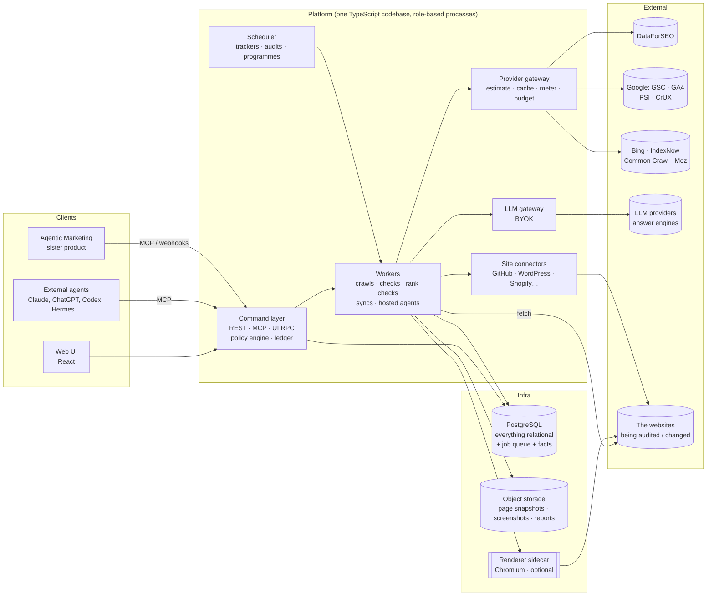

# Architecture: Agentic SEO

> Status: **design, before code** (2026-11-12). Nothing on these pages is built yet. They describe what we will build and why, and the order we will build it in. Decisions are recorded as ADRs in [`adr/`](adr/). A later ADR can overturn an earlier one; ADRs keep their original text.

## What we are building

An open-source, self-hostable **SEO platform built agent-first**. It is the sister product of [Agentic Marketing](https://github.com/TimChr78/Agentic-Marketing) and shares its approach, stack and look:

- **One command layer** powers the REST API, the MCP server and the web UI. Agents and people use the same surface, under the same permissions, approvals and audit log.
- **Feature parity with [OpenSEO](https://github.com/every-app/open-seo).** That covers keyword research, domain and competitor insights, SERP analysis, backlinks, rank tracking (including local), site audits with Lighthouse, AI visibility, Google Search Console and GA4, IndexNow, project memory, agent-written reports and an MCP server. The full matrix is in [feature-parity.md](feature-parity.md).
- **The depth of [claude-seo](https://github.com/AgriciDaniel/claude-seo)'s specialist audits, moved into the platform.** These are technical SEO, E-E-A-T and content, schema, sitemaps, Core Web Vitals, GEO and AI crawler access, agent readiness, hreflang, local, e-commerce, SXO, clustering and drift. They become deterministic checks in code plus LLM-judged checks, rather than prompts in a CLI plugin.
- **Agentic loops, not just agent tools.** OpenSEO gives an agent data, and claude-seo gives it a playbook. We add the part neither has: an agent can run the whole SEO loop inside borders a person sets, and the platform enforces those borders. The loop is *find → recommend → change the site → verify → learn*. Proposing stays the default, and people grant autonomy per agent, per action class and per site.
- **Bring your own keys** for data (DataForSEO, Google, Bing, Moz…) and for LLMs, with cost estimates, budgets and metering on every paid call.

## Constraints that shape everything

| Constraint | Consequence |
|---|---|
| Team of one, maintainability first; a sister product to Agentic Marketing | **Same stack, same patterns, same design system** as Agentic Marketing (TypeScript modular monolith, one image). We port proven packages instead of inventing new ones ([ADR-0001](adr/0001-sister-product-reuse.md)). |
| Self-hostable, `docker compose up` must work | **Few stateful components:** Postgres plus S3-compatible (or local) object storage. A headless browser is an optional sidecar ([ADR-0003](adr/0003-storage.md), [ADR-0005](adr/0005-rendering.md)). |
| Free and open source (MIT) | Permissive dependencies only; no paid service required to get value. The site audit, Search Console, GA4, PageSpeed/CrUX, Bing and Common Crawl all work without a paid key. |
| SEO data costs money per call | Every paid call goes through a **provider gateway** with estimates, caching, budgets and metering ([ADR-0004](adr/0004-data-provider-gateway.md)). |
| The product crawls arbitrary URLs | **SSRF-safe fetching, polite crawling** and per-host rate limits are core, not add-ons ([security-and-privacy.md](security-and-privacy.md)). |
| Agents are first-class users | The command registry generates REST, MCP and the UI client. Writes create drafts, and mandates, the policy engine and the action ledger are carried over from Agentic Marketing ([ADR-0006](adr/0006-agent-autonomy-for-seo.md)). |
| Changing a live website is risky | Site changes are **versioned change sets**. Each is applied through a connector, verified by a re-crawl, rolled back where the connector allows it, and watched by a guardian ([ADR-0007](adr/0007-change-sets-and-site-connectors.md)). |

## Document map

| Document | Contents |
|---|---|
| [overview.md](overview.md) | System context, runtime roles, module boundaries, the main flows |
| [domain-model.md](domain-model.md) | Workspaces, sites, markets, findings, recommendations, change sets, artifacts |
| [crawler-and-audits.md](crawler-and-audits.md) | Crawl engine, rendering, the check catalogue, health score, drift |
| [data-providers.md](data-providers.md) | DataForSEO, Google, Bing, Common Crawl, Moz, LLM answer engines; cost, cache and budgets |
| [agents-and-autonomy.md](agents-and-autonomy.md) | Command registry and MCP, SEO action classes, mandates, specialists, programmes, the closed loop |
| [security-and-privacy.md](security-and-privacy.md) | SSRF, crawl etiquette, credentials, tenancy, GDPR |
| [tech-stack.md](tech-stack.md) | Technology choices, the delta from Agentic Marketing, and what we do not use |
| [feature-parity.md](feature-parity.md) | OpenSEO and claude-seo capabilities mapped to our modules and phases |
| [roadmap.md](roadmap.md) | The implementation plan: spikes, phases and "done" criteria |
| [open-questions.md](open-questions.md) | Decisions needed from the product owner |
| [../design/DESIGN.md](../design/DESIGN.md) | UI design: inherited design system, navigation, screens, SEO-specific components |
| [adr/](adr/) | Architecture Decision Records |

## The architecture in one picture

## Headline decisions

1. **A sister product that reuses Agentic Marketing's foundations.** We port its packages and conventions instead of starting from a blank page, and we do not fork OpenSEO. [ADR-0001](adr/0001-sister-product-reuse.md)
2. **A TypeScript modular monolith in one image, with role-based processes:** `api`, `worker`, `scheduler`, `all`. [ADR-0002](adr/0002-modular-monolith.md)
3. **Postgres is the only required database.** It also holds the job queue, the crawl frontier and partitioned fact tables. Object storage holds blobs. ClickHouse is a later upgrade path, not a v1 dependency. [ADR-0003](adr/0003-storage.md)
4. **Every paid or rate-limited external call goes through a provider gateway** with typed ports, estimates, caching, credit holds and budgets. [ADR-0004](adr/0004-data-provider-gateway.md)
5. **Our own HTTP crawler, with rendering as a pluggable sidecar:** a built-in Playwright renderer, Crawl4AI or Browserless. Lighthouse data comes from PageSpeed Insights by default. [ADR-0005](adr/0005-rendering.md)
6. **Agentic Marketing's autonomy model, re-cut for SEO:** mandates, levels L0–L4, SEO action classes, a structured reach estimate (traffic at risk, critical pages, template reach) with cumulative limits, and a guardian that rolls back verified technical failures and pauses on traffic anomalies. [ADR-0006](adr/0006-agent-autonomy-for-seo.md)
7. **Site changes are versioned change sets applied through connectors,** with re-crawl verification and rollback. A GitHub pull request is the first connector. [ADR-0007](adr/0007-change-sets-and-site-connectors.md)
8. **Checks are code, recommendations are reasoned.** Deterministic checks produce findings with evidence. LLM-judged checks are sampled and budgeted. Every recommendation states a hypothesis, the expected leading indicator and how we would know it failed. [ADR-0008](adr/0008-checks-findings-recommendations.md)
9. **MIT licence for the whole project.** This matches Agentic Marketing.
