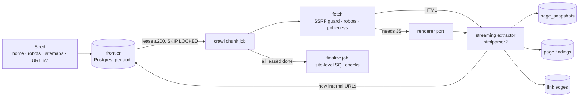

# Crawler and audits

> Status: design (2026-11-12). Informed by OpenSEO's [site audit crawl architecture](https://github.com/every-app/open-seo/blob/main/docs/maintainers/specs/0009-site-audit-crawl-architecture.md) (lessons about memory, step size and invisible failure) and claude-seo's specialist audits (what to check).

## 1. Goals

- **Useful with no paid keys.** A full technical, on-page, schema, GEO and agent-readiness audit runs on the crawl alone. Core Web Vitals come from the free PageSpeed Insights and CrUX APIs.
- **Bounded memory.** No step holds the whole site. Pages are parsed by streaming, and state lives in Postgres.
- **Visible failure.** Every audit ends `completed`, `partial` (with reason) or `failed` (with reason). A reconciler finds stuck audits. Pages already crawled are always viewable.
- **Polite.** It obeys robots.txt (the user can explicitly override this only for a verified own site). It uses per-host concurrency and backoff and an honest user agent.
- **Safe.** All fetching goes through the SSRF guard ([security-and-privacy.md](security-and-privacy.md)).

## 2. Crawl engine



- **Frontier** is a Postgres table keyed `(audit_id, url_hash)`, with state `pending / leased / crawled / skipped`, depth, discovered-from and a lease chunk number. It reuses the "table as queue" pattern that Agentic Marketing's journey runtime validated (`FOR UPDATE SKIP LOCKED`).
- **Chunks** are Graphile Worker jobs. Each leases up to about 200 URLs and crawls them with a **rolling concurrency window**: the next fetch starts as soon as one settles. The window adapts between 2 and 32, **and per-host concurrency is a global limit across all worker replicas** (a lease table in Postgres), so adding workers never multiplies the load on a site. The window adapts on error rate, latency and 429/503 responses. A soft deadline releases unfinished leases. Retries are idempotent: chunk-keyed leases, deterministic snapshot ids and upserts.
- **Order.** Pages reached by links come first, breadth-first by depth, because a link gives a page its click depth. Sitemap-only pages come next. A per-section quota keeps one huge section from using the whole page limit.
- **Extraction** is a streaming SAX pass ([htmlparser2](https://github.com/fb55/htmlparser2)). It collects title, meta, canonical, robots, hreflang, `<h1>`–`<h6>`, links (with rel and anchor text), images (src, alt, dimensions, loading), JSON-LD/microdata/RDFa blocks (parsed with remote `@context` loading **disabled**; schema.org contexts come from a bundled copy), Open Graph and Twitter cards, word count, the main-content text hash (for duplicates), language, and resource hints. Raw HTML is optionally gzipped to object storage.
- **Link edges** live in a per-audit table, which a `DROP` of its partition clears after finalize. Before the drop, finalize keeps the evidence that findings and change sets need: inlink and outlink counts, anchor-text samples, the source pages of broken links, and the edges to and from key pages.
- **Completion** is atomic. An audit finalizes only when, in one transaction, no frontier row is `pending` or `leased` and no chunk job is running. A chunk persists newly discovered URLs **before** it marks its own URLs `crawled`, so discovery is never lost between chunks.
- **Coverage.** Every audit records whether its link graph is complete or truncated (page limit, time limit, robots, errors). Graph checks (orphans, depth, internal PageRank) are **suppressed** on a truncated graph, as OpenSEO does. An issue is only marked *resolved* by an audit whose coverage includes the affected pages; otherwise it stays open as "Not re-checked".
- **Identity.** The fetched URL, the final URL after redirects and the declared canonical are stored separately. Pages are never merged on a canonical the site declares, because a wrong canonical is itself a finding.
- **Finalize** runs site-level checks as SQL: orphans (in sitemap, no inlinks), broken internal links, redirect chains, canonical cycles, duplicate titles, descriptions and content, hreflang reciprocity, depth distribution, and the internal PageRank approximation.
- **Reconciler** (scheduler, every minute): an audit with no progress for N minutes becomes `partial` or `failed` with a recorded reason.

### Sizes we design for

| Tier | Pages per audit | Notes |
|---|---|---|
| Default | 10,000 | Single `all` process, 2 vCPU |
| Large | 100,000 | More worker replicas; raw HTML off by default |
| Beyond | — | Section-scoped audits plus sitemap sampling; revisit with spike 1 ([roadmap.md](roadmap.md)) |

## 3. Rendering

Most SEO checks need the raw HTML: it is what crawlers see first. Rendering is needed for JS-only sites, for rendered-vs-raw diffs, for screenshots (visual and mobile checks) and for local Lighthouse.

The `fetch` package defines a **renderer port**:

```ts
interface Renderer {
  render(url: string, opts: { device: 'mobile' | 'desktop'; waitFor?: string; timeoutMs: number;
    screenshot?: boolean; blockThirdParty?: boolean }): Promise<RenderResult>; // html, console, network summary, screenshot ref
  lighthouse?(url: string, opts: { device: 'mobile' | 'desktop' }): Promise<LighthouseResult>;
}
```

Adapters ([ADR-0005](adr/0005-rendering.md)):

| Adapter | When |
|---|---|
| `builtin` | The optional `renderer` sidecar image (Playwright + Chromium), started with a Compose profile |
| `crawl4ai` | An existing Crawl4AI server (bearer token in secrets) |
| `browserless` | A Browserless or other CDP endpoint |
| `none` | Default. Raw HTML only; render-dependent checks report "Not evaluated: no renderer" and are never treated as passed |

Render modes per audit: `never`, `auto` (render pages where the raw HTML has little text but many scripts, or a sampled 1-in-N), and `always`.

## 4. Performance data

- **CrUX API and CrUX History API** are the **field-data** source: URL-level where Google has enough data, origin-level as a separately labelled fallback, with the 25-week trend. INP, LCP and CLS only; FID is never used. Field data for a template is not inferred from a few sample URLs: the UI shows the URL-level data or "Origin data", never "template field data".
- **PageSpeed Insights API** (free; an API key raises the quota) is used for **lab** Lighthouse only, on 1–3 representative URLs per template cluster. We do not rely on PSI for field data, because Google has announced that PSI will stop returning CrUX data.
- **Local Lighthouse** through the renderer when PSI is unavailable or the site is private.
- LCP sub-parts and preload checks (as in claude-seo `lcp_subparts`, `preload_check`) where a render is available.

## 5. The check catalogue

A check is code:

```ts
export const titleTooLong = defineCheck({
  id: 'title.too_long',
  category: 'on_page',
  severity: 'low',                 // critical | high | medium | low | info
  scope: 'page',                   // page | site | link | template
  kind: 'deterministic',           // deterministic | judged
  appliesTo: (p) => p.isIndexable && p.isHtml,
  run: (p) => p.title && pixelWidth(p.title) > 580
    ? fail({ value: p.title, expected: '≤ 580 px (≈ 60 characters)' }) : pass(),
  explain: 'Google truncates titles wider than the result column…',
  fix: { change: 'meta.title' },   // which change type can fix it, if any
  references: ['https://developers.google.com/search/docs/appearance/title-link'],
});
```

Each check carries a test fixture. A synthetic "bad SEO" test site (as OpenSEO's `tests/badseo`) exercises the whole catalogue end to end.

**Categories and examples** (the v1 target is about 120 deterministic checks plus 10 judged ones):

| Category | Examples | Source of inspiration |
|---|---|---|
| Crawlability | robots.txt fetch/parse errors, blocked important pages, sitemap errors, sitemap URLs not 200/indexable, crawl depth > 4, orphan pages | claude-seo technical, sitemap |
| Indexability | noindex on pages with traffic, canonical to non-200/noindex/redirect, canonical cycles, conflicting signals (noindex + canonical), soft 404 | claude-seo technical |
| Status and links | 4xx/5xx, redirect chains (>1 hop), loops, 302 for permanent moves, broken internal/external links, links to redirects, nofollow internal | OpenSEO audit |
| On-page | missing, duplicate, too long or too short title and description; missing or multiple H1; heading order; thin content (thresholds per page type); duplicate content | OpenSEO, claude-seo content |
| Structured data | parse errors, invalid against Schema.org and Google's rich-result requirements, deprecated types (HowTo; FAQPage reported as info only), missing recommended properties, mismatch with visible content | claude-seo schema |
| International | hreflang return links, invalid codes, x-default, hreflang to non-canonical, language mismatch | claude-seo hreflang |
| Images | missing alt, oversized, no dimensions (CLS), non-modern formats, LCP image lazy-loaded | claude-seo images |
| Performance | CWV (INP, LCP, CLS) per template from CrUX, Lighthouse opportunities, render-blocking resources, TTFB | claude-seo performance |
| Mobile and rendering | viewport, tap targets, content differences between raw and rendered HTML, JS-only links | claude-seo visual |
| Security | HTTPS, mixed content, HSTS, insecure forms | claude-seo technical |
| GEO and AI crawlers | robots rules for GPTBot, ClaudeBot, PerplexityBot, Google-Extended, CCBot…; `llms.txt` presence and validity; answer-first passages; citability signals (stats, sources, author, dates) | claude-seo geo |
| Agent readiness | accessibility-tree quality for agents, Markdown alternates, WebMCP or agent-facing manifests, form labelling | claude-seo agentic |
| Local | NAP consistency on site vs GBP, LocalBusiness schema, location page quality, the 30/50 location-page gates | claude-seo local |
| E-commerce | Product/Offer schema, price and availability consistency, faceted navigation crawl traps, out-of-stock handling | claude-seo ecommerce |
| Programmatic | template uniqueness ratio, index bloat | claude-seo programmatic |
| Judged (LLM) | E-E-A-T signals, helpfulness and search-intent match, SXO page-type fit, content freshness, title/description quality, AI-citability of key passages | claude-seo content, sxo, geo |

**Judged checks** run on a **sample** (key pages from site context, the top traffic pages from GSC, one page per template cluster). They have a per-audit token budget. Their output schema is fixed (score, rationale, quoted evidence), they are logged in the AI decision log, and they are marked "Assessed by AI" in the UI. A judged check never produces a `critical` finding alone.

**Freshness rules** (as claude-seo's quality gates) live as data next to the checks, with a `reviewed_at` date. Examples: FAQ rich results retired in May 2026; HowTo deprecated; INP replaced FID. CI warns when a rule is more than 6 months unreviewed.

## 6. Health score

`score = 100 − Σ_category weight_c × penalty_c`, where `penalty_c` grows with the severity of open issues and the share of affected indexable pages, weighted by each page's traffic share when GSC is connected. The score is capped per category so one category cannot zero it. The weights are in the code and documented. The UI always shows the score with its period, its denominator (pages evaluated) and the categories **not evaluated** (for example "Performance not evaluated: no PSI key"). It never shows 100 for "nothing checked", following the design rule that no data never means healthy.

## 7. Drift monitoring

A **baseline** freezes chosen fields for key pages and site-wide files: title, description, canonical, robots, H1, schema hash, status, hreflang set, robots.txt and sitemap hashes, the content hash and CWV. A **drift audit** is a lightweight scheduled crawl of those URLs. It compares them with the baseline and emits `drift.detected` with a typed diff. Expected changes, those made by an applied change set, are matched and not reported. This is claude-seo's `drift` moved into the scheduler, and it feeds the guardian.

## 8. Crawler access to protected sites

For staging sites and sites behind bot protection (as OpenSEO's crawler access), the options are:

- custom request headers and basic auth;
- a cookie jar;
- a verified-bot allow-list token;
- a user-agent override for owned sites only.

Credentials live in `secrets` and are used only for hosts of the site they belong to.
