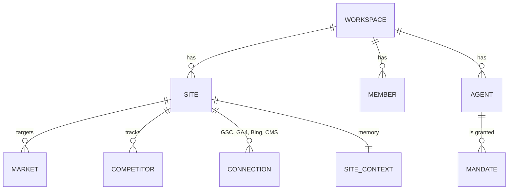
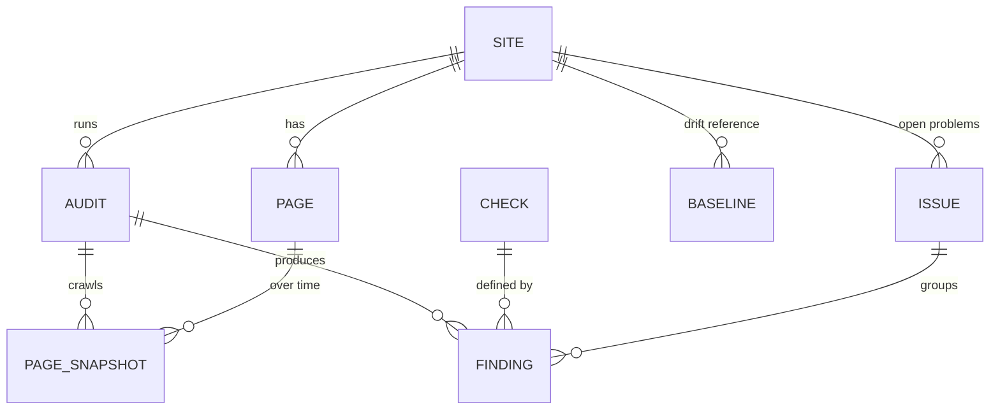
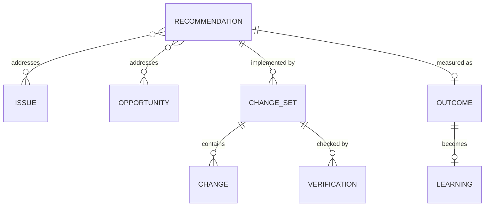

# Domain model

> Status: design (2026-11-12).

Every table carries `workspace_id`, and Postgres row-level security enforces it from day one, as in Agentic Marketing. Most SEO objects also carry `site_id`.

## 1. Tenancy and scope

| Object | What it is | Notes |
|---|---|---|
| **Workspace** | A tenant: a person, a team or an agency | Roles: owner, admin, editor, approver, viewer (Agentic Marketing's five, with "marketer" renamed "editor") |
| **Site** | A website we are responsible for (OpenSEO calls it a "project") | Primary domain plus hosts (`www`, subdomains), ownership verification state, business type (SaaS, local, e-commerce, publisher, agency, detected then confirmed), default market |
| **Market** | A location and language pair (DataForSEO location code + language code; GSC country) | A site can have several; rank trackers and research are per market |
| **Competitor** | A domain that competes in a market | Suggested from SERP overlap; curated by people or agents |
| **Connection** | An OAuth or API-key link to GSC, GA4, Bing Webmaster or a CMS/site connector | Secrets in `secrets`; one per site per kind |
| **Site context** | The shared memory: business overview, goals, positioning, writing preferences, key pages, research log | A versioned singleton artifact, exposed as `site-context://<site>` (OpenSEO's "project memory", Agentic Marketing's business context) |

## 2. Crawling and checks

| Object | What it is |
|---|---|
| **Page** | A canonical URL we know about, stable across audits. It carries the latest status, template cluster, and GSC clicks and impressions (last 28 days) to weight impact |
| **Audit** | One crawl with scope (whole site, section, list, single page), limits (pages, depth, duration), render mode, state and failure reason |
| **Page snapshot** | What we saw for a page in one audit: status, timing, headers, extracted SEO fields (title, meta, canonical, robots, hreflang, headings, schema blocks, links, images, word count, content hash), plus an optional raw HTML/screenshot pointer in object storage |
| **Check** | A rule in code (`checks` package) with an id (`title.missing`), category, default severity, scope (page, site, link), and `deterministic` or `judged` kind |
| **Finding** | One check failing (or passing, for judged checks) on one subject, with evidence (selector, value, expected, source URL) |
| **Issue** | The site-level, long-lived grouping of findings for one check: opened, regressed, resolved, ignored (with reason). Issues are what people triage; findings are evidence |
| **Baseline** | A frozen set of snapshot fields used for drift detection (claude-seo `drift`) |
| **Health score** | 0–100, computed per audit from weighted issue severities and the share of affected pages ([crawler-and-audits.md](crawler-and-audits.md) §6) |

## 3. Research and tracking

| Object | What it is |
|---|---|
| **Keyword** | Text + market, with cached metrics (volume, difficulty, CPC, intent, trend) and `fetched_at` |
| **Keyword list** | Saved keywords (OpenSEO "saved keywords"), with tags and target page |
| **Cluster** | A group of keywords that share SERP results, with a pillar or target page; the output of `research.cluster` |
| **SERP snapshot** | Results for one keyword/market/device at a time, including SERP features and AI Overview presence and citations |
| **Domain profile** | Cached domain overview: estimated traffic, ranked keywords, top pages, competitors, backlink summary |
| **Backlink profile** | Referring domains, anchors, new and lost links; sources: DataForSEO, Common Crawl graph, Moz, Bing |
| **Rank tracker** | Keywords × market × device × schedule, with an optional local location (city/region) |
| **Rank observation** | Partitioned fact: tracker, keyword, date, position, URL, SERP features |
| **Local grid** | A geo-grid local rank check for a business and keyword (claude-seo `maps`, OpenSEO local SEO) |
| **AI visibility tracker** | Prompts × engines × market × schedule, with brand and competitor names to match |
| **AI answer** | One engine's answer to one prompt on one run: mentions, citations (sources), sentiment, position |
| **Search facts** | Three separate GSC datasets, because summing detail rows never reproduces totals (anonymised queries, row limits): **property totals** (date, search type), **page aggregates** (date, page, country, device) and **query detail** (date, query, page…). Each row set records aggregation type, search type, completeness and a finality watermark. Plus GA4 organic landing-page facts. Partitioned by month |

## 4. The agentic loop

| Object | What it is |
|---|---|
| **Opportunity** | Something worth doing that is not a defect: striking-distance keywords (positions 8–20 with impressions), decaying pages, a content gap against competitors, missing AI citations, unclaimed local listings. Produced by detectors over search facts and research data |
| **Recommendation** | A versioned artifact. It holds: title, rationale, the evidence it rests on (issue/finding/fact ids), **hypothesis**, expected impact (traffic at stake, confidence), effort, dependencies on other recommendations, **verification plan** (what to re-check and when), **falsification check** ("how would we know this failed?") and a **leading indicator**. The last four come from claude-seo's synthesis method, made structural |
| **Change set** | A versioned artifact: an ordered set of **changes** to one site through one connector, with a diff per URL and a rollback plan. States: draft → in review / held → applying → (for PR connectors: PR open → merged) → deploying → deployed → verified / verification failed → measuring → outcome; or rolled back / superseded. Each state records the commit or CMS revision it refers to. An edit to an open PR after approval sends the change set back to review |
| **Change** | One typed edit: `meta.title`, `meta.description`, `canonical`, `robots.meta`, `redirect`, `robots_txt`, `sitemap`, `schema.jsonld`, `hreflang`, `image.alt`, `internal_link`, `content.patch` (Markdown/HTML diff), `content.new_page`, `llms_txt` |
| **Verification** | The re-fetch and re-check of affected URLs after apply: pass/fail per change, with evidence |
| **Outcome** | The measured result after the measurement window: GSC clicks, impressions and positions on affected URLs/queries against a pre-registered control cohort, plus rank observations. Verdict: confirmed, refuted, inconclusive or confounded ([agents-and-autonomy.md](agents-and-autonomy.md) §10) |
| **Learning** | A conclusion with evidence ("For this site, rewriting titles of striking-distance product pages raised CTR 18% ±6% over 28 days, n=24"), in the learnings store that agents read as `learnings://<site>` |

## 5. Artifacts (versioned, reviewable)

These go through drafts, diffs and approvals, like Agentic Marketing's artifacts: `site_context`, `recommendation`, `change_set`, `content_brief`, `schema_template`, `report`, `report_template`, `rank_tracker`, `ai_visibility_tracker`, `audit_profile` (saved crawl settings, check overrides), `agent_mandate`, `hosted_agent`, `skill` (specialist playbook), `prompt`.

Trackers are artifacts because a tracker is a recurring spend commitment. Changing one goes through the same policy as any other spend.

## 6. Agent control objects (ported)

`agent`, `agent_mandate`, `hold`, `action_ledger`, `guardian_episode`, `learning`, `hosted_run`, `agent_event_subscription`. These have the same semantics as in [Agentic Marketing's autonomy design](https://github.com/TimChr78/Agentic-Marketing/blob/main/docs/architecture/agentic-autonomy.md). SEO-specific action classes and tripwires are in [agents-and-autonomy.md](agents-and-autonomy.md).

## 7. Retention

| Data | Default |
|---|---|
| Raw HTML snapshots | Last 2 audits per site (configurable) |
| Page snapshots (extracted fields) | 13 months |
| Screenshots | Last audit only |
| Rank observations, search facts, AI answers | 25 months (GSC itself keeps 16) |
| Provider response cache | Per endpoint TTL (e.g. keyword metrics 30 days, SERP 24 hours) |
| Action ledger, audit log | Indefinite (hash-chained) |
