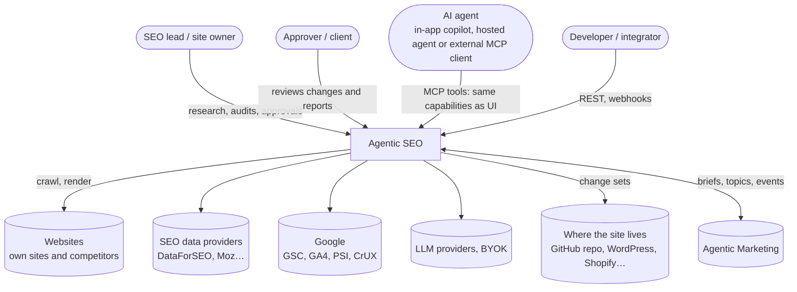
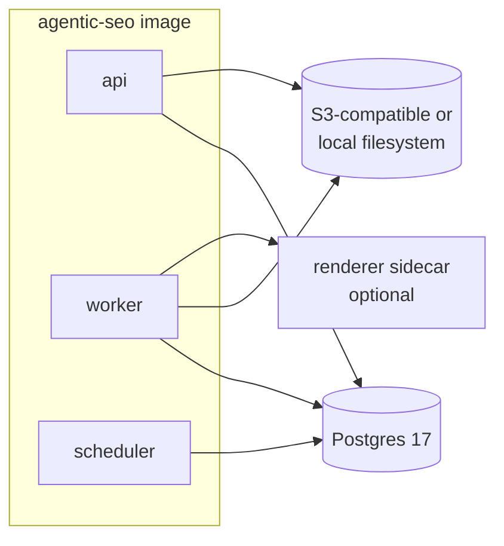
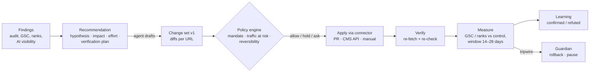

# System overview

> Status: design (2026-11-12). Describes the target for wave 1; see [roadmap.md](roadmap.md) for the order.

## 1. System context



## 2. Runtime roles

The platform is **one codebase and one container image**. A `ROLE` environment variable selects which modules a process runs, as in Agentic Marketing. There is no `ingest` role, because SEO has no visitor hot path.

| Role | Responsibility | Latency class | Scales by |
|---|---|---|---|
| `api` | Command layer (REST, MCP, UI RPC), auth, OAuth for MCP, static UI, public share links | interactive (<300 ms) | users and agents |
| `worker` | Graphile Worker jobs: crawl chunks, rendering requests, check evaluation, provider calls (rank checks, research), Google syncs, change-set application, verification, hosted agent runs, report rendering | seconds to minutes | crawl pages/s, jobs/s |
| `scheduler` | Cron: tracker schedules, scheduled audits, GSC/GA4 daily syncs, programme runs, retention, budget resets | seconds | one replica |
| `all` | Everything in one process (the default for Compose) | — | — |

**Sidecar (optional): `renderer`.** A separate image (`agentic-seo-renderer`) with Playwright and Chromium. It exposes a small authenticated HTTP API for rendering, screenshots and local Lighthouse. The main image stays small. Rendering can also go to an external Crawl4AI or Browserless instead ([ADR-0005](adr/0005-rendering.md)).



## 3. Module boundaries (packages)

Packages marked **port** are carried over from Agentic Marketing and adapted ([ADR-0001](adr/0001-sister-product-reuse.md)). **New** packages are SEO-specific.

| Package | Origin | Responsibility |
|---|---|---|
| `core` | port | IDs (`site_…`, `aud_…`), errors, time, brand constants, config |
| `db` | port | Drizzle schema, migrations, RLS role, partition helpers |
| `commands` | port | `defineCommand`, the registry, REST/MCP/UI surfaces, policy hooks, idempotency, rate limits |
| `auth` | port | Better Auth, roles, API tokens, MCP OAuth 2.1, agents as principals, SSO later |
| `artifacts` | port | Versioned artifacts, drafts, diffs, approvals, mandates |
| `secrets` | port | Envelope encryption, key rotation, KMS/OpenBao providers |
| `telemetry` | port | OpenTelemetry, pino, Prometheus `/metrics` |
| `client` | port | Typed UI client |
| `ai` | port | LLM gateway (Vercel AI SDK), budgets, decision log, prompt artifacts |
| `sites` | new | Sites, markets, competitors, verification of ownership, business context |
| `fetch` | new | SSRF-safe HTTP client, robots.txt, per-host politeness, the renderer port |
| `crawl` | new | Frontier, chunked crawl, extraction (streaming HTML parse), link graph, snapshots |
| `checks` | new | Check catalogue, findings, issues, health score, drift baselines |
| `providers` | new | Provider gateway: ports, adapters (DataForSEO, Google, Bing, Moz, Common Crawl, LLM engines), cache, metering |
| `research` | new | Keywords, SERP, domains, competitors, backlinks, clustering, saved lists |
| `tracking` | new | Rank trackers, local grids, AI visibility trackers, schedules, history |
| `search-data` | new | GSC and GA4 connections, syncs, fact tables, opportunities |
| `recommendations` | new | Synthesis, prioritisation, hypotheses, verification plans, learnings |
| `changes` | new | Change sets, site connectors, apply, verify, rollback |
| `reports` | new | Agent-written HTML reports, report templates, share links |
| `agents` | port + new | Hosted runtime, specialists, programmes, guardian (SEO tripwires) |
| `integrations` | port | Signed webhooks, connector SDK, OAuth connections, the Agentic Marketing bridge |

Rule: a package talks to another package only through its exported service interface. Only `providers` calls paid external APIs, and only `fetch` touches arbitrary URLs.

## 4. Main flows

### 4.1 Site audit

```mermaid
sequenceDiagram
  participant U as Person or agent
  participant API as Command layer
  participant W as Worker
  participant F as fetch / renderer
  participant DB as Postgres
  U->>API: audits.run(site, scope, limits)
  API->>API: policy (crawl class, page limit, budget)
  API->>DB: audit row + seed frontier (home, sitemaps)
  API-->>U: auditId, status URL
  loop crawl-chunk-N (lease ≤200 URLs)
    W->>F: fetch (robots, politeness, SSRF guard)
    F-->>W: response (+ render if needed)
    W->>DB: pages, page findings, edges, new frontier URLs
  end
  W->>DB: finalize: site-level checks (orphans, broken links, duplicates)
  W->>W: CrUX field data + PSI lab for sampled templates; LLM-judged checks on samples
  W->>DB: issues, health score, drift vs baseline
  W-->>U: event audit.completed → recommendations job
```

### 4.2 Recommendation → change → verification (the closed loop)



### 4.3 Rank tracking and other scheduled data

The scheduler enqueues tracker runs. The worker asks the provider gateway for an estimate and places a **credit hold** against the workspace budget. It then calls the provider, writes the results to partitioned fact tables, releases the unused hold and emits events: `rank.changed`, `rank.lost_top10`, `ai_visibility.changed`. Agents subscribe to these events through webhooks or `agents.events`, as in Agentic Marketing.

### 4.4 Agent session over MCP

An external agent connects to `/mcp` with OAuth 2.1. On the consent screen a person chooses its scopes. The agent then reads `site-context://<site>` and `learnings://<site>`, calls research and audit tools (paid tools show their estimated cost before running), and drafts recommendations or change sets. It submits them under its mandate. Everything is recorded in the action ledger.

## 5. Events (internal and for agents)

Internal events are rows in an outbox table, dispatched by the worker. There is no NATS: volumes are low, and Postgres `LISTEN/NOTIFY` plus the outbox is enough ([ADR-0003](adr/0003-storage.md)).

`audit.completed`, `audit.failed`, `issue.opened`, `issue.resolved`, `drift.detected`, `rank.changed`, `rank.lost_top10`, `gsc.anomaly`, `ai_visibility.changed`, `recommendation.created`, `changeset.applied`, `changeset.verified`, `changeset.rolled_back`, `guardian.episode`, `budget.threshold`, `report.saved`.

## 6. Relationship to Agentic Marketing

The two products are separate deployments with separate databases. They connect over their public surfaces only:

- **Content:** an approved SEO content brief can be pushed to Agentic Marketing's editorial topic backlog (`content.topics.*`) with its SEO signals. A published article's URL comes back as a page to track.
- **Agents:** an Agentic Marketing hosted agent can hold an MCP connection to Agentic SEO (and the other way round), as an agent with its own mandate.
- **Look and feel:** the same design tokens, components and copy rules ([../design/DESIGN.md](../design/DESIGN.md)).
- **Later (open question):** shared SSO and a product switcher; shared packages extracted into a common library ([open-questions.md](open-questions.md)).
